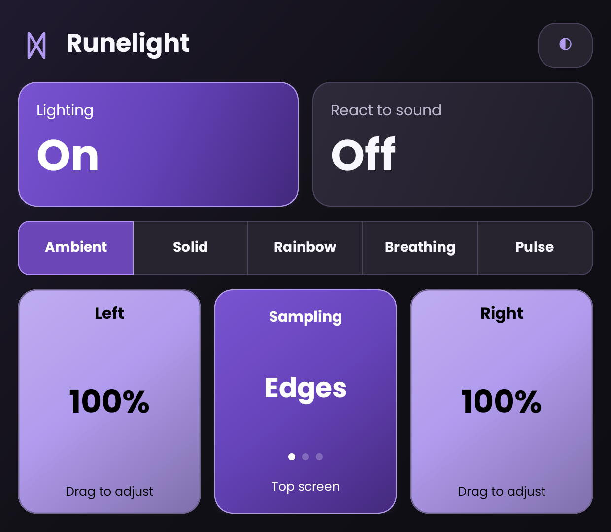

# Runelight

A personal LED utility for the **AYN Thor Max**, built around reliable lighting
and simple controls that fit the lower screen. Runelight is a fork of
[Bifrost](https://github.com/Pollux-MoonBench/Bifrost).

**Work in progress:** the current internal build supports top-screen Ambient,
Solid, Rainbow, Breathing and Pulse, with playback sound reaction on Ambient,
Solid and Rainbow. Bottom-source Ambient remains in development.



## Current controls

- A full-tile Lighting button with explicit Start/Stop and observed service state.
- Direct effect selection with no forced off/on pause between the four working effects.
- A separate React to sound tile; Breathing/Pulse pause it while retaining saved On.
- Independent left/right brightness: drag either color tile vertically.
- Inline color wheel with live LED preview while lighting is running. Apply saves;
  Cancel, Back or leaving the UI restores the saved values.
- Copy the other side’s color and brightness into the editor before applying.
- A center Speed tile for animated effects; Ambient has Edges / Screen halves / Full screen sampling.
- Dark/light appearance and saved settings.
- A foreground notification with Stop, plus a Quick Settings shortcut to the controls.

The configuration fits the Thor’s lower screen without scrolling at the tested
font size. The UI also supports the top screen and Android display movement;
the owner confirmed basic Pathfinder movement. Capture-specific Pathfinder and
larger-font acceptance remain pending.

Lighting continues when the UI is closed or its task is dismissed. Explicit Stop
ends the session. Reopening the app does not automatically restart lighting after
an interruption; it offers Start to resume manually.

Plain effects with sound Off need no screen-capture consent, Accessibility, Usage Access or
battery-exemption setup. Notification permission is optional on Android 13, but
is needed to show the normal notification-drawer controls.

## Ambient and sound

Ambient samples the **top screen**, independently of where the controls are
shown. Tap the center Sampling tile to cycle:

- **Edges:** each outer 12.5% band drives its corresponding side.
- **Screen halves:** each half’s representative color drives its corresponding side.
- **Full screen:** one whole-picture representative color drives both sides.

Colorful-pixel weighting plus a modest brightness/saturation lift keeps scene
colors distinct. Side brightness stays independent. Sampling changes reuse capture; smoothing
converges on held content and preserves black. Start asks for Android screen-capture
consent. Samples stay in memory; no recording is saved. After capture stops,
Start requests fresh consent. See the [implementation and tested limits](docs/ambient-implementation-2026-10-21.md).

**React to sound** layers playback intensity over Ambient, Solid or Rainbow.
Each side's brightness is its maximum; quiet playback dims it and silence fades
it to zero. Breathing/Pulse dim and disable the sound tile while keeping its
saved On preference. Returning to a supported effect resumes sound with valid
consent. Ambient and sound share one capture session. During the pause, Android
may still show the retained capture authorization; Stop releases it.

Sound requests audio permission and Android capture consent when needed. It uses
playback capture, with no microphone fallback or saved recording. Source apps can
prohibit playback capture. See the [sound implementation and tested limits](docs/sound-implementation-2026-10-21.md).

Debug-only probes have demonstrated top-screen MediaProjection, explicit
Accessibility sampling of both displays, and playback-capture combinations on
the Thor. These experiments do not establish production Ambient/audio reliability.
Bottom-source support will expose its actual permission/backend requirements.
See the [POC plan](docs/poc-plan.md) and [capture findings](docs/ambient-probe-2026-10-20.md).

Presets, app profiles, schedules, boot start, plugins/external APIs, wallpapers
and battery/temperature effects are outside the POC. Active legacy service policies
and startup/API receiver registrations have been removed; the remaining inherited
source and resources still need the [planned cleanup](docs/cleanup-inventory.md).

## Build and test

Use **JDK 17**, the checked-in Gradle wrapper and the pinned Android SDK/dependencies.
See [BUILDING.md](BUILDING.md) for setup, APK installation and device-test commands.

```sh
./scripts/dev.sh doctor
./scripts/dev.sh unit
./scripts/dev.sh build
./scripts/dev.sh lint
./scripts/dev.sh release
```

The debug APK is generated at `app/build/outputs/apk/debug/app-debug.apk`.
Runelight uses application ID `io.github.marcinsz89.runelight`; debug builds add
`.debug`. Bifrost releases and its Obtainium source install the upstream app.

Latest recorded validation on the owner’s **Thor Max / Android 13**:

- The current increment passes 99 JVM regressions and focused Thor tests.
  Controlled playback drives physical Ambient intensity; unsupported-mode pause,
  automatic resume and retained video capture were checked on the Thor. See the
  [sound report](docs/sound-implementation-2026-10-21.md) and earlier [Ambient report](docs/ambient-implementation-2026-10-21.md).
- Debug and release assembly, including release shrinking and vital lint, completed.
- Full debug lint still fails on two inherited errors in the old audio analyzer
  and the Android 13 Quick Settings collapse call.

This is a development build. The lower-screen Home/lock/unlock restoration issue
remains open; it also reproduced with Settings and the installed Bifrost debug
baseline. Quick Settings panel interaction, capture revocation/game acceptance,
representative game audio, long gameplay sessions and Android 14+ acceptance remain unverified.
An owner-reported intermittent white Ambient output after idle OLED cleanup
remains unresolved; a subsequent cleanup recovered correctly. Audio/LED lag with
sound On was traced to vendor command backlog; the [paced-output correction](docs/sound-latency-2026-10-21.md)
passes a sustained load check and owner-observed sound alignment. Faster color
response is also implemented; representative games and longer sessions remain
acceptance work. See the
[current service results](docs/service-state-2026-10-21.md) and
[device test matrix](docs/device-test-matrix.md) for the precise scope and limits.

## Development notes

- [Project guidance](AGENTS.md)
- [POC scope and next steps](docs/poc-plan.md)
- [UI design and screenshots](docs/design/README.md)
- [Inherited-code review](docs/reviews/2026-10-20-inherited-code.md)
- [Capture/service reference comparison](docs/reviews/2026-10-20-capture-service-references.md)

## Attribution and license

Runelight derives from [Pollux-MoonBench/Bifrost](https://github.com/Pollux-MoonBench/Bifrost).
Thanks to the upstream authors and contributors, including
[KuriGohan-Kamehameha](https://github.com/KuriGohan-Kamehameha).
Upstream attribution and derivative source history are preserved.

Licensed under [GNU GPLv3](LICENSE). See [third-party notices](THIRD_PARTY_NOTICES.md)
for the color picker and its shipped license.
