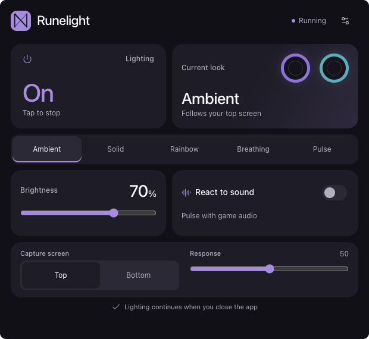

# Proposed design — Quick tiles

Selected by the owner on 2026-10-20; then refined to give Runelight its own identity.

- [Interactive standalone mockup](quick-tiles.html) — open locally in a browser.
- [Editable source fragment](quick-tiles.fragment.html).
- [Saved preview image](quick-tiles.png).
- Current native configuration in [dark](native-quick-tiles.png) and
  [light](native-quick-tiles-light.png), plus the [inline picker](native-color-picker.png).
- [Surface and motion refinement](../ui-polish-2026-10-21.md) — current styling work.

The files are design references. Values, readiness messages and LED colors are
illustrative; the mockup does not read audio, capture a display or control LEDs.
Its two preview rings represent desired colors, not hardware telemetry.

A first [native UI slice](../native-ui-increment.md) now implements the Quick
tiles direction. Its [Thor screenshot](native-quick-tiles.png) shows real native
controls. Ambient and sound remain unavailable in that internal build.
The native layout now supersedes the original mockup's redundant Current look
tile: sound sits beside Lighting, followed by the effect strip and paired
Left/Right color-level controls. The global brightness slider has been removed.
The HTML/image above preserve the earlier proposal.

## Visual direction

- Dark graphite surfaces, restrained lavender accent, simple light variant.
- **ᛞ Dagaz** day/daylight motif as the mark; no lightning logo. The prototype
  uses a Unicode glyph; the Android asset should render consistently without
  relying on the device's installed rune font.
- Layered cards, modest corners, sentence-case labels and a unified effect strip.
  ThorTune inspired the directness and large controls; the refined styling is
  specific to Runelight. No theme packs or artwork; animation provides brief
  interaction feedback and settles completely afterward.
- Active Lighting and sound tiles use a full-surface violet gradient with white
  text; inactive tiles use the normal light/dark card surface. Keep explicit
  state text as well as color. Lighting highlights only after the running state
  is observed; sound remains inactive while unavailable in the current build.
  The whole sound tile is the toggle; there is no separate switch inside it.
- Backgrounds use a restrained violet-to-neutral gradient. Inactive surfaces use
  shallow diagonal shading and fine edges; light mode has its own high-contrast
  palette. Color/Speed tiles have subtle highlights and shaded fills, keeping
  labels readable across their gradient. Shaders are cached until size/color changes.
  Dark-mode tiles use stronger highlights/shadows across the visible fill so
  gradients remain apparent at low levels; light mode retains its softer treatment.
- Effect selection blends fill and edge over 180 ms. Main tiles have an 80 ms
  press and 160 ms release; acknowledged activation adds a restrained violet
  shadow and a 160 ms surface fade. Respect Android's animation setting and
  finish transient animations on UI closure. No continuous glow/pulse loop.
- Bundle Poppins Regular/Bold, matching Cocoon's font assets, for the native
  interface. Main On/Off labels use 38sp and occupy the former subtitle space;
  trimmed font padding keeps the existing tile height and main control positions.
- Main tiles show their title and state without secondary instructions. Keep
  Start/Stop and unavailable explanations in accessibility labels.
- A working effect handoff keeps the acknowledged On state until the next frame
  arrives. Appearance recreation binds that state immediately, without replaying
  activation. Cold starts still wait for real output acknowledgement.
- The selected effect uses a strong accent fill and contrasting bold text so
  the selection remains obvious beside the active tiles, in both appearances.
- Plain labels throughout: Lighting and Start/Stop. No "Call Heimdall" or
  mythology-based names that require learning what a control does.
- Edit colors inline, preserving unfinished values across recreation. Apply
  explicitly; keep Stop accessible while editing.

## Main screen

| Region | Purpose |
|---|---|
| Header | Rune/name and light/dark appearance action |
| Lighting tile | Large direct Start/Stop control; reflects acknowledged engine state |
| React to sound tile | Beside Lighting; separate on/off option; sensitivity shown only when enabled |
| Effect strip | Ambient, Solid, Rainbow, Breathing, Pulse; changes directly |
| Left / Right tiles | Drag each rounded color tile vertically for that side's brightness; tap to edit color where the effect supports manual colors |
| Center Speed tile | Same vertical control between Left/Right for animated effects; omitted for Solid |
| Center Whole screen tile (Ambient) | HomeKit-style toggle for Custom Sampling: On samples throughout both image halves; Off uses edge regions; the entire tile toggles |
| Error feedback | Startup/hardware errors only; hidden during normal operation |

The selected segment is the effect indicator; no separate Current look summary
is needed. Lighting and sound stay accessible above the fixed configuration.

Effect controls:

- Ambient: capture Top/Bottom, response, and the center **Whole screen** sampling
  toggle; saturation under Settings initially. The toggle uses the center slot
  occupied by Speed in animated effects, keeping independent Left/Right levels.
- Solid: left/right colors; no animation speed control.
- Rainbow: speed; no unused manual-color picker in the Android UI.
- Breathing and Pulse: left/right colors and speed.

All effects retain independent left/right output levels. The two levels start
from the previous global setting when upgrading. Rainbow's tiles control levels
while its animation owns the colors. Ambient remains unavailable pending capture
integration; do not present the manual tile color as a measured Ambient preview.

Color editing replaces the effect strip/configuration area, retaining the header
and Lighting/sound tiles. Use the embedded native ColorPickerView wheel with a
Runelight selector. The editor has three columns: a large wheel on the left;
selected-side title, animated color preview and hex/level details in the middle;
and Apply, Copy other side and Cancel stacked on the right. The three actions
share the full available height, with 12dp gaps and matching rounded corners.
No RGB slider stack, extra dialog or scrolling.
Copy includes both color and brightness but only changes the draft. On a running
effect, draft colors preview on the LEDs without restarting the animation.
Cancel/Back/closing the UI restores saved settings; Apply persists the draft.
While stopped, color selection previews only on screen and never starts lighting.

Animated effects use three equal columns: **Left / Speed / Right**. Solid uses
two wider color/level tiles. The separate horizontal speed row is removed. Keep
normal status silent; display actual startup/hardware errors in context. The
temporary “Ambient capture is being rebuilt” footer has been removed.

Ambient's Whole screen option carries forward the intent of Bifrost's Custom
Sampling. Define Edges versus Whole screen explicitly; do not inherit the old
two-pixel default as a purported edge algorithm. Both modes use an aspect-correct
grid, preserve left/right mapping and true black, and update sampling within the
existing session without new capture consent. This control is planned for the
Ambient implementation; Ambient remains unavailable in the current native build.

The prototype still uses a shared generic color/speed context for Rainbow. Correct
that conditional visibility during Android implementation; the table above is
the intended behavior. Users never need to name/save a preset to change a setting.

## Sound is an overlay

The selected look remains the source of color and animation. The sound envelope
modulates its intensity; each side's brightness remains its output ceiling. Black
Ambient content stays at zero, with sound either on or off. A sound toggle must
not replace the effect or reset its colors/source.

One sensitivity slider is enough for the POC. Silence floor and response defaults
remain tuning decisions in the plan. Request playback capture permissions when
sound is enabled; never switch to a physical microphone as a fallback.

## Lower-screen and lifecycle behavior

Design for the Thor lower display first. Measure its actual density, insets and
available dp rather than converting the mockup's CSS pixels directly to Android
dimensions. Use at least 48dp effective touch targets, readable text, labeled
controls and room for system bars. The current configuration fits without
scrolling at the owner's default font size; larger-font adaptations still need
verification and must preserve core actions rather than silently clipping them.
Keep Start/Stop accessible while settings are open.
The saved mockup's settings overlay currently requires closing it to reach the
main power tile; the Android implementation should retain a Stop action there.

The UI must also fit the top display, survive movement/recreation, and preserve
draft colors/selected effect without restarting valid capture. The UI's display
does not select the Ambient source. Avoid a forced relaunch tug-of-war with
Pathfinder or the launcher; test direct launch and moving separately.

## Honest status and permissions

- Starting / Running / Stopped describe engine state, not merely service existence.
- Waiting for capture permission / Capture lost provide a user reconnect action.
- Sound unavailable does not falsely show active audio reaction; the selected
  base effect can continue under the proposed fallback.
- Hardware unavailable is explicit. A one-way vendor transaction does not prove
  the physical LEDs reached a measured color.
- Settings updates are live; no stop/delayed-start cycle for parameter changes.
- Standard effects request no screen/audio/Accessibility/Usage Access permission.
  Ambient and sound ask only for their applicable capabilities at first use.
- Closing the UI continues lighting; explicit Stop always wins. The footer's
  continuation claim is valid only once that behavior is implemented and tested.

## Prototype verification and export

The refined concept was checked at desktop and narrow widths, including touch
targets, effect selection, independent sound, brightness, Start/Stop, Settings
and light appearance. Native Android results and remaining display/lifecycle
limits are recorded in [the UI increment](../native-ui-increment.md).
The standalone export is saved with the repo and needs no server, network or app
account. It embeds Lucide 1.8.0 from the local runtime, preserves its license in
[THIRD_PARTY_NOTICES.txt](THIRD_PARTY_NOTICES.txt), and omits the export wrapper's
unused tooltip CDN scripts. Its interactions are verified with network blocked.
The fragment is retained for future edits; the full HTML is the openable version.
When regenerating the export, repeat the offline bundling check rather than
silently restoring external scripts. The HTML asset does not ship in the APK.
