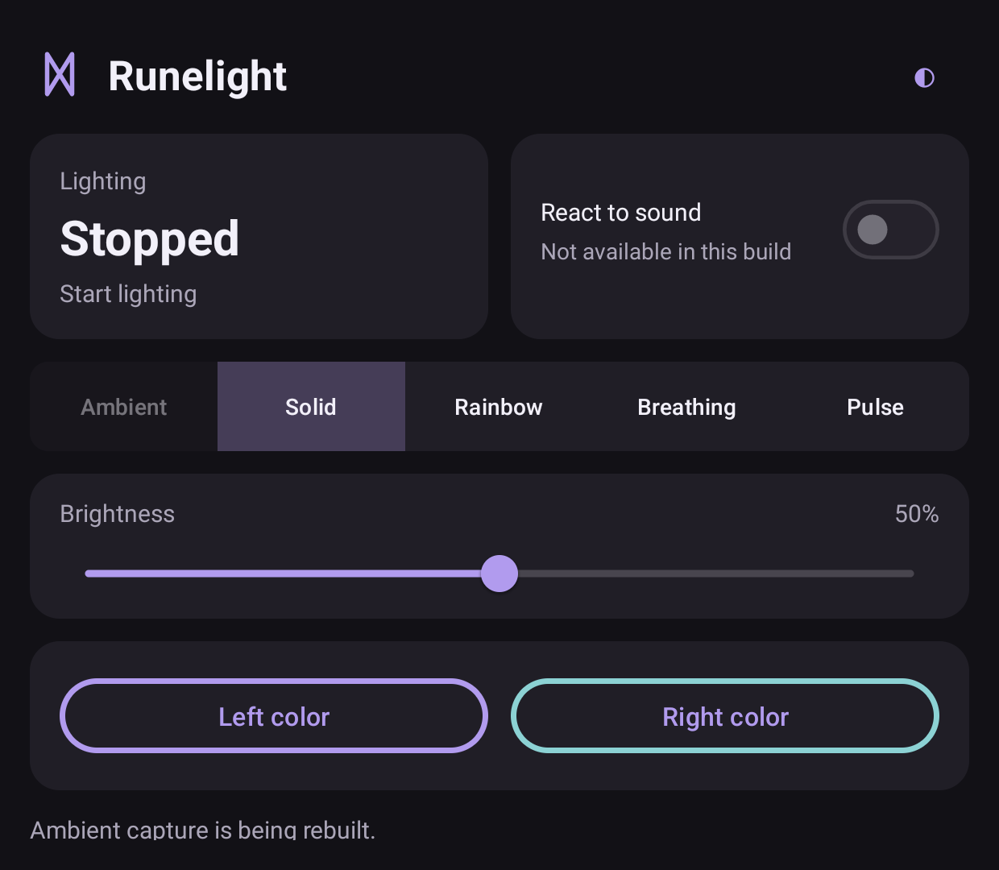

# First native Quick tiles increment — 2026-10-20

Runelight now has a native Android home screen based on the selected design.
This is an internal UI increment, not the completed five-effect POC.

The screenshot above shows the compact layout refinement below. The first
layout's Current look tile has been removed.

## Implemented

- Plain Lighting / Start lighting / Stop lighting labels, Dagaz mark and
  Runelight app/notification identity. No "Call Heimdall".
- Solid, Rainbow, Breathing and Pulse through the inherited engine. Direct
  effect, brightness, relevant speed and left/right color controls.
- Light/dark appearance and remembered settings. An inline RGB editor preserves
  drafts through recreation and commits only on Apply. Stop stays accessible.
- No presets, app profiles, plugin prompts, wallpaper, schedules or onboarding
  wizard in the new UI. Ambient and independent sound are visibly unavailable
  pending their engine work; the full five-effect POC scope remains unchanged.
- Android owns the UI display; the new Activity does not relaunch/finish a moved
  task. Explicit Stop dispatches immediately, without Activity-owned debounce.
  Start allows background continuation independently of boot/API preferences.

`RunelightActivity` owns views, saved manual settings and unconfirmed drafts;
LEDService owns active effects/output. Recreation/control synchronization sends
no Start/Stop command. The service exposes its started effect and vendor binder
availability; absent hardware no longer silently starts a service.

Application ID is `io.github.marcinsz89.runelight` (debug suffix `.debug`), while
the code namespace stays `com.moonbench.bifrost`. MainActivity is internal legacy
code and no longer the launcher. Notification taps open the new screen. Deferred
components still exist and require deliberate removal; hiding them is not final
retirement. The inherited version string/counter remain 1.3.1-debug / 16 for now.

## Verification

Thor Android 13 / API 33, firmware `Thor_V1.0.0.377_20260206_165408_user`:

| Check | Actual result |
|---|---|
| Debug and Android test APK assembly | PASS |
| Release assembly, R8/resource shrinking, vital lint | PASS; unsigned APK |
| Existing JVM suite | PASS: 60 tests, no failures/errors/skips |
| Native instrumentation | PASS: 2 tests; effect restoration without Start and unapplied draft restoration |
| Full debug lint | FAIL: 3 inherited errors, 400 warnings; no diagnostics in the new UI files |
| Lower launch and Solid layout | PASS; core controls fit at current font/density |
| Light/dark toggle while stopped | PASS; no lighting Start |
| Start and four available effects | PASS engine/UI state; logs confirm selected effects start |
| Live brightness | PASS; 40% → 29%, retained through movement |
| Three round trips 4 → 0 → 4 while running | PASS; same task, effect/settings retained |
| Move with inline color editor open | PASS; editor survives, Cancel accessible |
| Home and reopen | PASS; service continues, UI reflects it |
| Stop then immediately move 4 → 0 → 4 | PASS; stays stopped, service absent afterward |
| Final bounded smoke logs | No fatal exception or leaked window; crash buffer empty |

Logs show five effect starts corresponding to initial Solid and four explicit
selection actions, then one cleanup at explicit Stop. Display moves and
Home/reopen added no effect starts. The final smoke harness completed
successfully; the app was left stopped on the lower screen.

Early tests encountered Espresso 3.5 injecting clicks into display 0, plus a
focus timeout when recreating a host with a separate picker window. Final
lifecycle tests discover an active display and invoke controls on their owning
thread. The independent ADB smoke run checks real touch input with explicit
display IDs. The inline editor removes the picker window lifecycle entirely;
both recreation tests then passed.

| First-increment artifact (before compact layout refinement) | SHA-256 |
|---|---|
| Debug | `78b55491d1daf887033728c2f72ca170d0536ff8292b37256dfadb47eccea642` |
| Unsigned release | `0d908a274c5da2516b3950f976787ef49a964354a14751f30b7ed0b6d80fbcdd` |

Local evidence: ignored `local-test-results/2026-10-20-quick-tiles/`. The saved
screenshot was inspected and contains only app UI. No source, APK or raw logs
were uploaded; no commit or push was made.

## Compact layout refinement — 2026-10-20

- Removed the redundant Current look tile and its label-update code/resources.
  The checked effect segment is now the sole selected-effect indicator.
- Moved React to sound beside Lighting. Both remain above the scrolling area,
  keeping Start/Stop accessible during inline color editing.
- Placed brightness below the effect strip as a full-width slider.
- Sound and Ambient remain unavailable pending their engine increments.

Validation of this revision:

- `./scripts/dev.sh build :app:assembleDebugAndroidTest --offline`: PASS under
  Java 17. Debug app and test APKs installed successfully on the Thor.
- `RunelightActivityTest`: PASS, 2 tests on the Thor. Effect selection stays
  checked through recreation without starting lighting; an unapplied color
  draft survives recreation. Assertions now observe the effect segment directly.
- Lower-screen layout: PASS at the current font/density, in light and dark
  appearance. The top cards share a measured height, sound is beside Lighting,
  and brightness spans the available width below the effect strip. Solid's
  controls fit without scrolling; animated effects' extra speed control scrolls.
- Real display-specific touch: PASS for Start, Pulse selection, brightness
  40% → 50% and Stop. Appearance changes while stopped did not start lighting.
- Android task move 4 → 0 → 4: PASS; same task retained Pulse and 50% brightness,
  stayed running until explicit Stop. Top rendering was captured; actual top
  touch and the owner's Pathfinder shortcut remain separate unrun checks.
- Bounded smoke logs contained no fatal exception or leaked window. The app was
  left stopped on the lower screen with Solid selected, 50% brightness and dark
  appearance. The saved screenshot was inspected and contains only app UI.

The smoke run completed after reconnecting USB and dismissing the Thor's system
screen-control overlay. These results cover the final aligned layout build;
earlier broad engine/device results above remain limited to the earlier build.

Local evidence: `local-test-results/2026-10-20-quick-tiles/layout-build.txt`,
`layout-instrumentation.txt`, `layout-smoke.txt` and `compact-layout/`. No commit
or push. Release assembly and the JVM suite were not rerun for this layout-only
refinement; their earlier results above are historical.

Tested debug APK SHA-256:
`65dfc4780a64f8f75ff7b3bdbfbc81e29b96883f7225e59760f7e832b3c0df19`.

## Limits and next work

Binder availability and a started animation do not establish measured physical
RGB accuracy, all-zone mapping or true black/off. Steady Solid's inherited write
loop, per-zone crossfade state, full capture/error feedback, durable running
intent and rapid stop/start cleanup still need their planned work. Apply-color
output accuracy was not measured in this slice.

New-build movement was tested through Android's task API. A fresh test with the
owner's actual Pathfinder shortcut and enabled/disabled comparison remains
pending. Top rendering was captured; top touch/visibility with its panel awake,
larger fonts, task swipe/OEM cleaner, sleep/wake, long sessions, performance,
Ambient/audio and Android 14+ are outside this smoke test.
